# NammaMart Quick Commerce — ETL & ELT Pipeline Submission

**Learner:** Anaz A
**Module:** FDAIE Module 2 · Data Engineering Foundations
**DAGs:** `dags/nammamart_etl_anaz.py`, `dags/nammamart_elt_anaz.py`
**Warehouse:** `include/warehouse_anaz.duckdb`

> All results come from runs on the real NammaMart data, 21–22 Oct 2026. Generated reports: `include/reports/profiling/` (Part 0) and `include/reports/business_questions.md` (business questions, `dq_results` sample).

## Contents

- [Part 0 — Discovery and data profiling](#part-0--discovery-and-data-profiling)
- [Part A — ETL pipeline](#part-a--etl-pipeline)
- [Part B — ELT pipeline](#part-b--elt-pipeline)
- [Part C — Scheduling](#part-c--scheduling)
- [Part D — Data quality dimensions](#part-d--data-quality-dimensions)
- [Business questions](#business-questions)
- [Part E — Data governance](#part-e--data-governance)
- [Part F — Observability tests](#part-f--observability-tests)
- [Part G — Recommendation to the client](#part-g--recommendation-to-the-client)
- [Screenshots](#screenshots)

---

## Part 0 — Discovery and data profiling

### Method

1. **Profile.** `include/profiling/profile_nammamart.py` profiles all six files (row counts, nulls, duplicate keys, min/max of numeric and date columns, distinct category values), checks referential integrity and every client business rule. Output: `include/reports/profiling/profile_summary.md` and `issues_summary.csv` (52 raw findings).
2. **Investigate.** `include/profiling/followup_checks.py` looks behind each finding (payment-mode breakdowns, raw values, which columns differ in duplicates) to separate real problems from noise.
3. **Review.** Each finding was judged on four questions: *root cause* (merge symptoms of one problem), *real or noise*, *severity* (what happens if the row loads) and *where it belongs* (quarantine vs reconciliation).

Raw files were read as text and never modified. No personal data (names, emails, phones) appears in any report.

### Profile summary

| File | Rows | Key | Duplicate keys | Issues found |
|---|---|---|---|---|
| orders.csv | 2,412 | order_id | 12 exact duplicate rows | 17 |
| payments.csv | 2,228 | payment_id | 4 exact duplicate rows | 7 |
| customers.csv | 405 | customer_id | 5 IDs with two versions | 9 |
| products.csv | 152 | product_id | 2 IDs with two versions | 4 |
| stores.csv | 15 | store_id | none | 2 |
| orders_2026-10-01_increment.csv | 160 | order_id | none | 0 (clean) |

Deduplication explains the brief's numbers: 405 − 5 = **400 customers**, 152 − 2 = **150 products**.

### Referential integrity

| Relationship | Problem rows | Detail |
|---|---|---|
| orders.customer_id → customers | 18 | customer_id blank (no orphans among filled values) |
| orders.product_id → products | 9 | 9 IDs (P9212, P9399 …) outside the real range P0001–P0152 |
| orders.store_id → stores | 5 | S00, S17, S99, outside S01–S15 |
| payments.order_id → orders | 8 | Test-like batch: identical timestamp, order IDs like ORD970544 |
| increment → customers / products / stores | 0 | Clean |

### Business rules

| Rule | Result |
|---|---|
| order_amount = quantity × unit_price × (1 − discount_pct/100) | 18 mismatches, off by exactly ×10, ×1.5 or ×0.5, or caused by discounts above 100% |
| order_status ∈ {DELIVERED, CANCELLED, RETURNED} | 3 `Pending??`, 2 lower-case `delivered` |
| payment_mode ∈ {UPI, Card, Cash on Delivery, Wallet} | 2 `Cashh`; 6 variants (`upi`, `CARD`, `cod`); 2 with spaces |
| DELIVERED orders have delivery_minutes; normal range 8–35 | 8 missing; 6 values of 480–1,440 (likely seconds) |
| SUCCESS payment = order_amount | 14 mismatches; 10 zero or negative SUCCESS payments |
| Cancelled orders have no payment | Holds |
| Increment = new orders + corrections | Holds: 150 new (all 2026-10-01) + 10 corrections (all DELIVERED → RETURNED) |

### Data Issues Log

Severity: **Critical** rows are quarantined; **Warning** rows load and are logged.
**(changed)** marks a severity that differs from the brief's suggestion. Master-file rows are never quarantined in a way that orphans facts: the bad attribute is set to NULL or `UNKNOWN` instead, because quarantining store S12 would silently remove its 135 orders from revenue.

#### orders.csv

| ID | Row key (sample) | Column | Problem | Dimension | Severity | Proposed rule | Rows |
|---|---|---|---|---|---|---|---|
| DI-01 | ORD001462, ORD001441 | all | Whole row exported twice | Uniqueness | Critical | Keep first copy, quarantine repeats | 12 |
| DI-02 | ORD002255, ORD000701 | customer_id | Blank | Completeness | Critical | Quarantine | 18 |
| DI-03 | ORD000403, ORD000362 | order_ts | Blank (one is the text `N/A`) | Completeness | Critical | Treat `NULL`/`N/A`/`-` as missing; quarantine | 2 |
| DI-04 | ORD001610, ORD000534 | order_ts | Impossible dates: month 13, 31 September | Validity | Critical | Quarantine; parse with an explicit format | 4 |
| DI-05 | ORD002119, ORD001693 | order_ts | Future-dated, with round repeated times (e.g. 2027-01-01 09:00) | Timeliness | Critical | Quarantine; likely test orders | 7 |
| DI-06 | ORD000500, ORD001970 | order_status | `Pending??` | Validity | Critical | Quarantine | 3 |
| DI-07 | ORD001066, ORD000153 | order_status | Lower-case `delivered` | Validity | Warning | Upper-case | 2 |
| DI-08 | ORD001812, ORD001414 | payment_mode | `Cashh` (its payments have a gateway_ref, so not real cash) | Validity | Critical | Quarantine; don't guess the mode | 2 |
| DI-09 | ORD000159, ORD002356 | payment_mode | `upi`, `CARD`, `cod`, extra spaces | Validity | Warning | Trim and map to canonical value | 8 |
| DI-10 | ORD000469, ORD001296 | quantity | Zero (4) or negative (6); not returns, which use RETURNED + REFUNDED | Accuracy | Critical | Quarantine | 10 |
| DI-11 | ORD002305, ORD002298 | order_amount | Formula mismatch: exact ×10 / ×1.5 / ×0.5 (a system bug) | Accuracy | Critical | Quarantine, don't overwrite; ×10 rows alone overstate revenue by up to ₹35,400 | 18 |
| DI-12 | ORD002103, ORD001468 | discount_pct | 250, 120, 150 | Validity | Critical | Quarantine | 3 |
| DI-13 | ORD000986, ORD001058 | product_id | Not in products (P9xxx) | Consistency | Critical | Quarantine | 9 |
| DI-14 | ORD001799, ORD001046 | store_id | S00, S17, S99 | Consistency | Critical | Quarantine | 5 |
| DI-15 | ORD001554, ORD001800 | delivery_minutes | Missing on DELIVERED order | Completeness | Critical | Quarantine (client rule) | 8 |
| DI-16 | ORD001037, ORD002101 | delivery_minutes | 480, 900, 1440: as seconds = 8, 15, 24 min | Accuracy | Critical | Quarantine; convert ÷60 if the client confirms seconds | 6 |
| DI-18 | ORD000398, ORD001113 | order_id | DELIVERED with no SUCCESS payment: 44 failed, 28 none | Consistency | Warning **(changed)** | Not quarantined; reconciliation reasons `PAYMENT_FAILED` / `NO_PAYMENT_RECORD` | 72 |

#### payments.csv

| ID | Row key (sample) | Column | Problem | Dimension | Severity | Proposed rule | Rows |
|---|---|---|---|---|---|---|---|
| DI-19 | PAY0000509, PAY0001651 | all | Whole row exported twice (explains the "double SUCCESS" flags) | Uniqueness | Critical | Keep first copy | 4 |
| DI-20 | PAY0002217 – PAY0002224 | order_id | Orders don't exist; identical timestamp; likely gateway test batch | Accuracy | Critical | Exclude; reconciliation `ORPHAN_PAYMENT` (₹4,580.57) | 8 |
| DI-21 | PAY0001568, PAY0000354 | amount_paid | SUCCESS amount ≠ order_amount | Consistency | Warning **(changed)** | Not quarantined; reconciliation `AMOUNT_MISMATCH` | 14 |
| DI-22 | PAY0000751, PAY0000944 | amount_paid | Zero or negative SUCCESS payment | Accuracy | Critical | Quarantine | 10 |
| DI-23 | PAY0000396, PAY0000127 | payment_ts | Future-dated; all belong to DI-05 orders | Timeliness | Critical | Quarantine | 7 |
| DI-24 | PAY0000522, PAY0000044 | payment_mode | `Cashh` | Validity | Warning **(changed)** | Load as `UNKNOWN` (quarantine would fake a reconciliation exception) | 2 |
| DI-25 | PAY0002188, PAY0002113 | payment_mode | Variants and extra spaces | Validity | Warning | Trim and map | 8 |

#### customers.csv

| ID | Row key (sample) | Column | Problem | Dimension | Severity | Proposed rule | Rows |
|---|---|---|---|---|---|---|---|
| DI-27 | C00036, C00103 | customer_id | Two versions: old and new address/phone | Uniqueness | Critical | Deduplicate before join (else 29 orders double-count) | 10 |
| DI-28 | C00400, C00398 | signup_date | Future-dated | Timeliness | Warning **(changed)** | Load; set signup_date NULL | 3 |
| DI-29 | C00307, C00063 | email | `@` missing (5) or no `.com` (3) | Validity | Warning | Load; mask; log | 8 |
| DI-30 | C00337, C00045 | email | Text `n/a` | Completeness | Warning | Treat as missing | 4 |
| DI-31 | C00151, C00240 | phone | Not a valid 10-digit mobile | Validity | Warning | Load; mask; log | 7 |
| DI-32 | C00199, C00171 | loyalty_tier | `BRONZE`, `bronze`, `SILVER` | Consistency | Warning | Title case | 8 |
| DI-33 | C00355, C00394 | city | Blank | Completeness | Warning | Load | 6 |
| DI-34 | C00132, C00083 | pincode | Not 6 digits | Validity | Warning | Load; log | 3 |
| DI-35 | C00395, C00342 | pincode | Outside Bengaluru (not 56xxxx) | Consistency | Warning | Load; ask client | 2 |

#### products.csv

| ID | Row key (sample) | Column | Problem | Dimension | Severity | Proposed rule | Rows |
|---|---|---|---|---|---|---|---|
| DI-36 | P0030, P0140 | product_id | Second copy named `(old)` with older MRP | Uniqueness | Critical | Drop rows ending `(old)` | 4 |
| DI-37 | P0051, P0060 | category | Blank | Completeness | Warning **(changed)** | Load as `UNKNOWN`; fix at source | 3 |
| DI-38 | P0019, P0073 | cost_price | Exactly 1.2 × MRP (normal ≈ 0.8 ×) | Accuracy | Warning **(changed)** | Load; cost NULL; exclude from margin | 4 |
| DI-39 | P0109 | mrp | −203 (sign error) | Accuracy | Warning **(changed)** | Absolute value if confirmed, else NULL | 1 |

#### stores.csv

| ID | Row key | Column | Problem | Dimension | Severity | Proposed rule | Rows |
|---|---|---|---|---|---|---|---|
| DI-40 | S07 | zone | Blank (176 orders) | Completeness | Warning **(changed)** | Confirm with ops; `UNKNOWN` until then | 1 |
| DI-41 | S12 | capacity_orders_per_day | 0, yet 135 orders | Accuracy | Warning **(changed)** | Set NULL | 1 |

#### Removed as noise or merged

| Raw finding | Rows | Reason |
|---|---|---|
| DI-17 unit_price above MRP | 12 | All are product P0109, whose MRP is negative (DI-39). *Later restored as a Warning using only valid, current MRPs: Experiment 8b showed that removing the check also removed protection.* |
| DI-26 SUCCESS without gateway_ref | 285 | All Cash on Delivery, which never has a gateway reference; rule narrowed to UPI/Card/Wallet |
| Statistical outliers (order_amount, amount_paid, quantity) | 120 | Large baskets are legitimate; real errors are caught exactly by DI-10, DI-11, DI-21, DI-22 |
| order_amount negative; double SUCCESS; signup after first order; null-as-text; whitespace | 26 | Same rows as another issue (merged) |

**Result:** 52 raw findings → **39 issues** (20 Critical, 19 Warning) across every file.

### Key findings

- **Goods delivered without payment.** 72 delivered orders have no successful payment: 44 after a failed payment, 28 with no payment at all.
- **Errors are systematic.** Exact multipliers (×10, ×1.5, ×0.5, cost = 1.2 × MRP) point to source-system bugs, which should be fixed at source, not only cleaned downstream.
- **Test entries are found by behaviour, not names.** 8 payments share one timestamp and reference non-existent orders; 7 orders have round, repeated future timestamps.
- **Returns** are recorded as status RETURNED plus a REFUNDED payment (69 returns, 68 refunds), never as negative quantities.

### Questions for the client

1. **Unpaid deliveries:** 72 orders were delivered without a successful payment (44 failed, 28 none). Should they count as revenue, and is the business aware it's delivering after failed payments?
2. **Delivery time units:** six orders show 480, 900 or 1,440 minutes, which are 8, 15 and 24 minutes if read as seconds. Does any app or store record seconds?
3. **Customer versions:** five customers appear twice with different addresses. Which version is current, and should we keep the history?

---

## Part A — ETL pipeline

**Files:** `dags/nammamart_etl_anaz.py` (DAG wiring only) and `include/nammamart_etl.py` (all pipeline logic, testable without Airflow), using the shared rules in `include/dq_rules.py`.

### Flow (17 tasks)

```
extract_orders ─┐                       ┌─ validate_orders ──────────┐
extract_payments├─(parallel)─────────── ├─ validate_payments         │
extract_customers                       ├─ validate_customers        ├─ transform → load → reconcile → report → run_audit
extract_products│                       ├─ validate_products         │                                       (all_done)
extract_stores ─┤                       ├─ validate_stores           │
extract_increment (only with load_increment=true) └─ validate_orders_increment ┘
```

| Step | What it does |
|---|---|
| **Extract** | Five files in parallel, read exactly as received (all text). Schema is checked first: a renamed or missing column fails the task loudly instead of loading wrong data. |
| **Validate** | Applies the shared rules. Each row gets `dq_status` (PASS / WARN / FAIL) and a reason. |
| **Quarantine** | FAIL rows are written to `include/quarantine/anaz/<file>_failed_<run_id>.csv` exactly as received, with `failure_reason` as the first column. Nothing is dropped silently. |
| **Transform** | Repairs master-data attributes (zone/category → `UNKNOWN`, invalid MRP/cost/capacity → NULL), masks personal data, joins orders to all three dimensions, derives `order_date`, `net_revenue`, `gross_margin`, `within_15_min`. |
| **Load** | Star schema in `include/warehouse_anaz.duckdb`. |
| **Reconcile** | Compares loaded orders with `payments.csv` → `etl_payment_reconciliation`, one row per mismatch with a reason. |
| **Report** | Builds `etl_daily_zone_revenue` and `etl_category_margin` and prints them in the task log. |
| **Run audit** | `trigger_rule="all_done"`: writes one row to `pipeline_runs` even when the run fails. |

### Star schema

| Table | Grain | Notes |
|---|---|---|
| `etl_fact_orders` | one row per order_id (primary key) | `net_revenue` = order_amount for DELIVERED orders only; `gross_margin` = net_revenue − quantity × cost_price (NULL when cost is unknown); `within_15_min` for DELIVERED orders; `dq_warnings`; lineage columns `_source_file`, `_source_date`, `_run_id`, `_loaded_at` |
| `etl_dim_customer` | one row per customer_id | `customer_name_masked` (`P*** S***`), `email_masked` (`pr***@example.com`), `phone_masked` (`98******21`); no raw name, email or phone |
| `etl_dim_product` | one row per product_id | category `UNKNOWN` when blank; cost_price NULL when ≤ 0 or above MRP |
| `etl_dim_store` | one row per store_id | zone `UNKNOWN` when blank; `manager_name` (personal data) dropped as not needed |

### How the guarantees are met

- **No bad order reaches finance tables:** only PASS and WARN rows are loaded; every Critical failure is quarantined.
- **No double counting:** duplicate customers and products are resolved before the join, and the join is checked with `validate="many_to_one"`. The task fails if any dimension key is duplicated, instead of silently doubling revenue.
- **Idempotent load:** dimensions are fully replaced each run. The fact table is loaded per source file: that file's rows are deleted, then upserted on `order_id` (`INSERT … ON CONFLICT DO UPDATE`). Re-running gives identical row counts.
- **Late corrections are applied and never undone:** each fact row records its source file's business date. An upsert only overwrites a row when the incoming file is the same age or newer, so the 1 October increment turns DELIVERED orders into RETURNED, and re-running September later cannot turn them back.
- **Data hand-off:** tasks pass small pickle files in `include/tmp/anaz/<run_id>/`; XCom carries only paths and counts.
- **One DuckDB writer at a time:** only the sequential tasks (load onwards) open the warehouse, and `connect()` waits and retries if the ELT DAG holds DuckDB's single-writer lock.

### Running it

- Scheduled: 09:00 IST, Monday–Saturday.
- Manual: *Trigger DAG*. For the increment, *Trigger DAG w/ config* with `{"load_increment": true}`.
- `as_of` (default `2026-10-01`) is the run date used by the timeliness checks.

### Results

First run on the real data: `manual__2026-10-21T23:28:38.831953+00:00` (all 17 tasks green). "Passed" includes the rows with warnings; passed + quarantined = rows in.

| File | Rows in | Passed | Of which with warnings | Quarantined | Quarantined because |
|---|---|---|---|---|---|
| orders.csv | 2,412 | 2,308 | 79 | 104 | 107 Critical flags on 104 rows (3 rows broke two rules, e.g. a 250% discount also breaks the amount formula) |
| payments.csv | 2,228 | 2,199 | 22 | 29 | duplicates 4, zero/negative SUCCESS 10, orphan test batch 8, future-dated 7 |
| customers.csv | 405 | 400 | 41 | 5 | the older copy of each duplicated customer_id |
| products.csv | 152 | 150 | 8 | 2 | the two `(old)` catalogue rows |
| stores.csv | 15 | 15 | 2 | 0 | none: S07 (zone) and S12 (capacity) are repaired, keeping their 311 orders |
| **Total** | **5,212** | **5,072** | **152** | **140** | |

Every check's row count matches the Part 0 Data Issues Log exactly (for example orders: 18 missing customer_id, 12 duplicates, 18 amount mismatches; payments: 14 amount mismatches sent to reconciliation as warnings).

What the run demonstrates:

- **Master files lose only true duplicates.** 400 customers and 150 products remain, the counts the brief describes. Every attribute problem is repaired, so no order is orphaned.
- **Reconciliation exceptions stay in the data.** The 72 unpaid deliveries and 14 payment amount mismatches load as warnings and appear in `etl_payment_reconciliation`, instead of being hidden in quarantine.
- **The narrowed gateway rule holds:** `gateway_ref_present` reports 0 failures, confirming the 285 Cash on Delivery payments were noise (DI-26).

---

## Part B — ELT pipeline

**Files:** `dags/nammamart_elt_anaz.py` (wiring), `include/nammamart_elt.py` (loads raw data, runs SQL files), and every transformation as a `.sql` file in `include/sql/`.

### Flow (15 tasks)

```
extract_orders ─┐
extract_payments├─(parallel)─→ load_raw → staging_standardise → staging_quality_checks → staging_build
extract_customers                                                                              │
extract_products│              run_audit ← compare_with_etl ← build_marts ← merge_increment ← merge_orders
extract_stores ─┤             (all_done)
extract_increment (only with load_increment=true)
```

Python only moves data (read CSV as text → append to raw). Every transformation after that is SQL.

### The three layers

| Layer | Tables | Rule | SQL files |
|---|---|---|---|
| **Raw** | `raw_orders` (orders + increment), `raw_payments`, `raw_customers`, `raw_products`, `raw_stores` | All source columns as text, plus `_row`, `_loaded_at`, `_source_file`, `_run_id`. **Append-only:** never cleaned, never deleted. A retried task doesn't load the same file twice for one run. | (loaded by `load_raw`) |
| **Staging** | `stg_orders`, `stg_payments`, `stg_customers`, `stg_products`, `stg_stores` | Reads only the rows this run loaded. Casts types, standardises values, de-duplicates, masks personal data, repairs master attributes, flags every row with `dq_status` / `failure_reason` / `warning_reason`. **Bad rows stay, flagged FAIL.** | `common/00_macros.sql`, `staging/01_std_*.sql`, `staging/generated/0[2-4]_*.sql`, `staging/05_stg_*.sql`, `staging/06_merge_stg_orders.sql` |
| **Mart** | `mart_daily_store_kpis`, `mart_category_margin`, `mart_delivery_sla`, `mart_payment_reconciliation`, `mart_top_customers` (+ `mart_payment_mode_revenue`, `mart_rejected_summary`) | Only rows not flagged FAIL. Revenue logic defined once in the view `int_orders_enriched`; every mart reads from it. | `mart/00_int_orders_enriched.sql`, `mart/0[1-7]_mart_*.sql` |

**Same rules as the ETL.** The quality checks are not written twice. `include/dq_rules.py` writes them out as SQL into `include/sql/staging/generated/` (`python include/dq_rules.py --write-sql include/sql/staging/generated`), and `python include/dq_rules.py` proves the SQL and pandas versions flag exactly the same rows. The value-cleaning macros (`00_macros.sql`) mirror `standardise()` in the same file.

**Personal data in staging.** `stg_customers` holds only `customer_name_masked`, `email_masked`, `phone_masked`. Clear text exists only in `raw_customers` and the internal, per-run `stg_customers_std` (see Part E for access control). `manager_name` is not carried into `stg_stores`.

**Guard rails.** `int_orders_enriched` fails the task with a clear error if the join changes the row count (a duplicate dimension key) or a clean order has no matching store, product or customer, instead of silently miscounting revenue.

### Incremental load: the MERGE (`staging/06_merge_stg_orders.sql`)

- **Raw:** the increment's rows are appended to `raw_orders` with `_source_file = orders_2026-10-01_increment.csv`.
- **Staging:** the batch is upserted into `stg_orders` with `INSERT … ON CONFLICT (stg_key) DO UPDATE` (DuckDB's upsert, i.e. MERGE):
  - **Key:** `order_id` for rows that passed; `'<file>#<row>'` for rejected rows, so a bad copy stays visible without overwriting the real order.
  - **New orders are inserted; corrections overwrite the old row**, but only when the incoming file is the same age or newer (`_source_date`, taken from the file name). So the 1 October `DELIVERED → RETURNED` corrections are applied, and **re-running September afterwards cannot undo them**.
  - The task log prints `inserted_new`, `rewritten_same_file`, `updated_by_newer_file` and `kept_newer_version`.

Result on the real data (`merge_increment`, Experiment 3): 160 rows in batch, 0 rejected, **150 inserted_new, 10 updated_by_newer_file**, 0 duplicates; `stg_orders` 2,412 → 2,562.

### ETL vs ELT September totals

The `compare_with_etl` task checks this on every run: totals, revenue by zone, margin by category and reconciliation rows by reason, printing `ETL and ELT MATCH` or the rows that differ.

First ELT run on the real data, `manual__2026-10-22T00:42:44.550844+00:00`, compared with the ETL run from Part A. The `compare_with_etl` task printed **`RESULT: ETL and ELT MATCH`**.

| Metric (orders before 2026-10-01) | ETL | ELT | Match? |
|---|---|---|---|
| Orders loaded (passed critical checks) | 2,308 | 2,308 | ✅ |
| Delivered orders | 2,086 | 2,086 | ✅ |
| Net revenue | 1,134,962.80 | 1,134,962.80 | ✅ |
| Gross margin | 266,808.95 | 266,808.95 | ✅ |
| Rows rejected (all files) | 140 | 140 | ✅ |

Detail, also identical in both pipelines:

| Net revenue by zone | ₹ | | Gross margin by category | ₹ |
|---|---|---|---|---|
| West | 292,396.65 | | Staples | 62,906.27 |
| East | 291,804.25 | | Household | 51,031.69 |
| South | 241,228.80 | | Dairy & Bakery | 44,791.84 |
| North | 226,807.50 | | Personal Care | 44,752.98 |
| UNKNOWN (store S07, zone blank) | 82,725.60 | | Snacks & Beverages | 37,665.60 |
| | | | Fruits & Vegetables | 21,096.62 |
| | | | UNKNOWN (category blank) | 4,563.95 |

| Reconciliation reason | Rows (both) |
|---|---|
| PAYMENT_FAILED | 42 |
| NO_PAYMENT_RECORD | 27 |
| AMOUNT_MISMATCH | 13 |
| ORPHAN_PAYMENT (the test batch, DI-20) | 8 |
| PAYMENT_FOR_REJECTED_ORDER | 90 |

Notes on these numbers:

- **Why 69 unpaid deliveries, not Part 0's 72:** 3 of the 72 orders also failed a critical check (so they are not reportable revenue). Their payments now appear under `PAYMENT_FOR_REJECTED_ORDER`, together with the payments of all other quarantined orders. The same applies to the 14 → 13 amount mismatches.
- **The UNKNOWN zone carries ₹82,725.60** (about 7% of revenue): store S07's orders. Had S07 been quarantined for its blank zone, as the brief's suggested severity implies, this revenue would have vanished from every report. Repairing the attribute keeps it, visibly labelled, until ops confirm S07's zone.

**Why they match:** both pipelines use the same rules (`dq_rules.py`), the same cleaning definitions, the same de-duplication choices and the same revenue formulas. The only way they can differ is if one has loaded the increment and the other hasn't; the compare task detects that and says so.

**Where they legitimately differ:** in ELT, `raw_*` grows on every run (Experiment 2), and rejected rows remain queryable in staging with their reasons; in ETL they exist only in the quarantine CSV files.

---

## Part C — Scheduling

Both DAGs use:

```python
import pendulum
from datetime import timedelta

default_args = {
    "owner": "anaz",
    "retries": 2,
    "retry_delay": timedelta(minutes=5),
    "execution_timeout": timedelta(minutes=20),
}

@dag(
    schedule="0 9 * * 1-6",
    start_date=pendulum.datetime(2026, 10, 1, tz="Asia/Kolkata"),
    catchup=False,
    default_args=default_args,
)
```

**What is your cron expression?**
`0 9 * * 1-6`: minute 0, hour 9, every day of the month, every month, Monday (1) to Saturday (6).

**What time does the run show in UTC in the Airflow UI?**
**03:30 UTC.** IST is UTC+5:30, so 09:00 IST = 03:30 UTC. Airflow stores all times in UTC; the UI can be switched to show IST. The scheduled run's ID shows it: `scheduled__2026-10-22T03:30:00+00:00`.

**What would happen at 9 AM if the start_date had been left in UTC?**
The cron would be read in UTC, so the DAG would run at 09:00 UTC = **14:30 IST**, five hours after the 9:30 AM review. The numbers would arrive later than the manual Excel report they replace.

**What happens if the laptop or Docker is off at 9 AM?**
The scheduler isn't running, so nothing runs and nothing alerts anyone. When Airflow starts again, `catchup=False` means only the most recent missed run is created, not one per missed day, so the data arrives late but isn't processed twice. In production this requires an always-on server or a managed Airflow service, plus a freshness alert that fires if the data isn't ready by 9:15.

**Evidence: it ran on its own.** On Thursday 22 Oct 2026, both DAGs started at **09:00:00 IST** with no manual trigger (`scheduled__2026-10-22T03:30:00+00:00`, i.e. 03:30 UTC) and finished green within about a minute, ahead of the 9:30 review. Both DAG pages then showed **Next Run: 2026-10-23 09:00:00** (Friday). The two DAGs started at the same moment and shared the warehouse without failing: DuckDB allows one writer, so whichever started second waited for the lock and retried. On Wednesday, unpausing the ETL DAG created exactly **one** catch-up run (`scheduled__2026-10-21T03:30:00+00:00`) despite a 1 October `start_date`: `catchup=False` in action.

**Why `catchup=False`?**
Each run reprocesses the full source files, so running every missed day since `start_date` would repeat the same work many times and flood the logs. The business only needs today's numbers by 9 AM.

**Why these retry settings?**
Most failures here are transient (a file not yet copied, a DuckDB lock). Two retries five minutes apart absorb those, and a 20-minute timeout stops a hung task. Worst case (run + 2 retries) still finishes before the 9:30 review.

---

## Part D — Data quality dimensions

All checks live in **one file, `include/dq_rules.py`**, used by both pipelines. Each rule has a pandas version (ETL) and a DuckDB SQL version (ELT). Running `python include/dq_rules.py` is a parity test: it applies both versions to the same data and confirms they flag exactly the same rows, so ETL and ELT can't drift apart.

**Severity → outcome:** Critical → row quarantined (ETL) / `dq_status = 'FAIL'` (ELT). Warning → row loads, issue logged / `dq_status = 'WARN'`.
**Actions:** QUARANTINE · DEDUPE (extra copies quarantined, one version kept) · REPAIR (row loads, bad attribute set to NULL/UNKNOWN) · STANDARDISE (casing/spaces fixed) · RECONCILE (row loads and appears in the payment reconciliation) · LOG · ALERT (dataset-level).

### Rule catalogue (58 rules)

| Check | File | Dimension | Severity | Action | Rule | Issue |
|---|---|---|---|---|---|---|
| `customer_id_not_null` | customers | Completeness | Critical | QUARANTINE | customer_id is present | - |
| `email_present` | customers | Completeness | Warning | LOG | email is present | DI-30 |
| `city_present` | customers | Completeness | Warning | LOG | city is present | DI-33 |
| `order_id_not_null` | orders | Completeness | Critical | QUARANTINE | order_id is present | - |
| `order_customer_id_not_null` | orders | Completeness | Critical | QUARANTINE | customer_id is present | DI-02 |
| `order_ts_not_null` | orders | Completeness | Critical | QUARANTINE | order_ts is present | DI-03 |
| `delivered_has_delivery_minutes` | orders | Completeness | Critical | QUARANTINE | DELIVERED orders have delivery_minutes | DI-15 |
| `payment_id_not_null` | payments | Completeness | Critical | QUARANTINE | payment_id is present | - |
| `payment_order_id_not_null` | payments | Completeness | Critical | QUARANTINE | order_id is present | - |
| `gateway_ref_present` | payments | Completeness | Warning | LOG | SUCCESS UPI/Card/Wallet payments have a gateway_ref (COD never does) | DI-26 (revised) |
| `product_id_not_null` | products | Completeness | Critical | QUARANTINE | product_id is present | - |
| `category_present` | products | Completeness | Warning | REPAIR | category is present (else UNKNOWN) | DI-37 |
| `store_id_not_null` | stores | Completeness | Critical | QUARANTINE | store_id is present | - |
| `customer_id_unique` | customers | Uniqueness | Critical | DEDUPE | one version per customer_id: the LAST row in the file is kept (pending client) | DI-27 |
| `order_id_unique` | orders | Uniqueness | Critical | DEDUPE | only the first copy of an order_id loads | DI-01 |
| `payment_id_unique` | payments | Uniqueness | Critical | DEDUPE | only the first copy of a payment_id loads | DI-19 |
| `product_id_unique` | products | Uniqueness | Critical | DEDUPE | one row per product_id: rows named '(old)' lose, then first by _row | DI-36 |
| `store_id_unique` | stores | Uniqueness | Critical | DEDUPE | one row per store_id | - |
| `email_format` | customers | Validity | Warning | LOG | email looks like name@domain.tld | DI-29 |
| `phone_format` | customers | Validity | Warning | LOG | phone is a 10-digit Indian mobile after removing +91 / 0 | DI-31 |
| `customer_pincode_format` | customers | Validity | Warning | LOG | pincode is 6 digits | DI-34 |
| `loyalty_tier_allowed` | customers | Validity | Warning | REPAIR | loyalty_tier is Bronze, Silver, Gold or Platinum (else UNKNOWN) | - |
| `signup_date_valid` | customers | Validity | Warning | REPAIR | signup_date is a real date (else NULL) | - |
| `order_ts_valid` | orders | Validity | Critical | QUARANTINE | order_ts is a real ISO-8601 timestamp | DI-04 |
| `order_status_allowed` | orders | Validity | Critical | QUARANTINE | order_status is DELIVERED, CANCELLED or RETURNED | DI-06 |
| `order_payment_mode_allowed` | orders | Validity | Critical | QUARANTINE | payment_mode maps to UPI, Card, Cash on Delivery or Wallet | DI-08 |
| `discount_pct_in_range` | orders | Validity | Critical | QUARANTINE | discount_pct between 0 and 100 (blank = 0) | DI-12 |
| `order_status_standard` | orders | Validity | Warning | STANDARDISE | order_status already in canonical form | DI-07 |
| `order_payment_mode_standard` | orders | Validity | Warning | STANDARDISE | payment_mode already in canonical form (no variants or spaces) | DI-09 |
| `payment_ts_valid` | payments | Validity | Critical | QUARANTINE | payment_ts is a real ISO-8601 timestamp | - |
| `payment_status_allowed` | payments | Validity | Critical | QUARANTINE | payment_status is SUCCESS, FAILED or REFUNDED | - |
| `payment_mode_known` | payments | Validity | Warning | REPAIR | payment_mode maps to an allowed value (else loads as UNKNOWN) | DI-24 |
| `payment_mode_standard` | payments | Validity | Warning | STANDARDISE | payment_mode already in canonical form | DI-25 |
| `zone_allowed` | stores | Validity | Warning | REPAIR | zone is North, South, East or West (else UNKNOWN) | DI-40 |
| `store_pincode_format` | stores | Validity | Warning | LOG | pincode is 6 digits | - |
| `quantity_positive_integer` | orders | Accuracy | Critical | QUARANTINE | quantity is a whole number above 0 | DI-10 |
| `unit_price_positive` | orders | Accuracy | Critical | QUARANTINE | unit_price above 0 | - |
| `order_amount_matches_formula` | orders | Accuracy | Critical | QUARANTINE | order_amount = quantity x unit_price x (1 - discount_pct/100), within 0.01 | DI-11 |
| `delivery_minutes_plausible` | orders | Accuracy | Critical | QUARANTINE | delivery_minutes above 0 and below 120 | DI-16 |
| `delivery_minutes_normal_range` | orders | Accuracy | Warning | LOG | delivery_minutes inside the normal 8-35 range | - |
| `success_amount_positive` | payments | Accuracy | Critical | QUARANTINE | a SUCCESS payment is above 0 | DI-22 |
| `mrp_positive` | products | Accuracy | Warning | REPAIR | mrp above 0 (else NULL) | DI-39 |
| `cost_price_positive` | products | Accuracy | Warning | REPAIR | cost_price above 0 (else NULL, excluded from margin) | - |
| `cost_price_not_above_mrp` | products | Accuracy | Warning | REPAIR | cost_price <= mrp (else cost NULL, excluded from margin) | DI-38 |
| `capacity_positive` | stores | Accuracy | Warning | REPAIR | capacity_orders_per_day above 0 (else NULL) | DI-41 |
| `loyalty_tier_standard` | customers | Consistency | Warning | STANDARDISE | loyalty_tier uses one casing | DI-32 |
| `customer_pincode_bengaluru` | customers | Consistency | Warning | LOG | pincode is in Bengaluru (56xxxx) | DI-35 |
| `order_customer_exists` | orders | Consistency | Critical | QUARANTINE | customer_id exists in customers | - |
| `order_product_exists` | orders | Consistency | Critical | QUARANTINE | product_id exists in products | DI-13 |
| `order_store_exists` | orders | Consistency | Critical | QUARANTINE | store_id exists in stores | DI-14 |
| `unit_price_not_above_mrp` | orders | Consistency | Warning | LOG | unit_price not above the product's current MRP (invalid MRPs ignored) | DI-17 (restored) |
| `delivered_has_success_payment` | orders | Consistency | Warning | RECONCILE | DELIVERED orders have a SUCCESS payment | DI-18 |
| `payment_order_exists` | payments | Consistency | Critical | QUARANTINE | order_id exists in orders (orphans look like test transactions) | DI-20 |
| `success_amount_matches_order` | payments | Consistency | Warning | RECONCILE | a SUCCESS payment equals its order's order_amount | DI-21 |
| `signup_date_not_future` | customers | Timeliness | Warning | REPAIR | signup_date is not after the run date (else NULL) | DI-28 |
| `order_ts_not_future` | orders | Timeliness | Critical | QUARANTINE | order_ts is not after the run date | DI-05 |
| `orders_fresh` | orders | Timeliness | Warning | ALERT | the latest order is no more than 1 day older than the run date | - |
| `payment_ts_not_future` | payments | Timeliness | Critical | QUARANTINE | payment_ts is not after the run date | DI-23 |

### Coverage: every dimension is checked, in both pipelines

```
dimension  Accuracy  Completeness  Consistency  Timeliness  Uniqueness  Validity
file                                                                            
customers         0             3            2           1           1         5
orders            5             4            5           2           1         6
payments          1             3            2           1           1         4
products          3             2            0           0           1         0
stores            1             1            0           0           1         2
```

### Design decisions

- **Master rows are never quarantined for a bad attribute.** Product, customer and store attribute problems are REPAIR, not QUARANTINE, so their orders are never orphaned.
- **Reconciliation exceptions are not rejects.** `delivered_has_success_payment` and `success_amount_matches_order` are Warnings with action RECONCILE.
- **No rounding in the formula check.** `order_amount` is compared with the unrounded formula, with a 0.01 tolerance, because pandas and DuckDB round halves differently.
- **`NOT EXISTS`, not `NOT IN`, for key checks in SQL.** `NOT IN` returns no rows at all if the lookup list contains a NULL, which would silently pass every orphan.
- **Deduplication rules are explicit:** first copy of an order/payment, last row of a customer (pending client), non-`(old)` row of a product.

### `dq_results` sample

Checks that did not pass in the latest ETL run (generated by `include/reports/business_questions.py`):

```sql
SELECT dag_id, check_name, dimension, severity, rows_checked, rows_failed, status
FROM dq_results
WHERE run_id = (SELECT run_id FROM pipeline_runs WHERE dag_id = 'nammamart_etl_anaz' ORDER BY start_time DESC LIMIT 1)
  AND dag_id = 'nammamart_etl_anaz' AND status <> 'PASS'
ORDER BY status, check_name
```

| dag_id | check_name | dimension | severity | rows_checked | rows_failed | status |
|---|---|---|---|---|---|---|
| nammamart_etl_anaz | customers.customer_id_unique | Uniqueness | Critical | 405 | 5 | FAIL |
| nammamart_etl_anaz | orders.delivered_has_delivery_minutes | Completeness | Critical | 2412 | 8 | FAIL |
| nammamart_etl_anaz | orders.delivery_minutes_plausible | Accuracy | Critical | 2412 | 6 | FAIL |
| nammamart_etl_anaz | orders.discount_pct_in_range | Validity | Critical | 2412 | 3 | FAIL |
| nammamart_etl_anaz | orders.order_amount_matches_formula | Accuracy | Critical | 2412 | 18 | FAIL |
| nammamart_etl_anaz | orders.order_customer_id_not_null | Completeness | Critical | 2412 | 18 | FAIL |
| nammamart_etl_anaz | orders.order_id_unique | Uniqueness | Critical | 2412 | 12 | FAIL |
| nammamart_etl_anaz | orders.order_payment_mode_allowed | Validity | Critical | 2412 | 2 | FAIL |
| nammamart_etl_anaz | orders.order_product_exists | Consistency | Critical | 2412 | 9 | FAIL |
| nammamart_etl_anaz | orders.order_status_allowed | Validity | Critical | 2412 | 3 | FAIL |
| nammamart_etl_anaz | orders.order_store_exists | Consistency | Critical | 2412 | 5 | FAIL |
| nammamart_etl_anaz | orders.order_ts_not_future | Timeliness | Critical | 2412 | 7 | FAIL |
| nammamart_etl_anaz | orders.order_ts_not_null | Completeness | Critical | 2412 | 2 | FAIL |
| nammamart_etl_anaz | orders.order_ts_valid | Validity | Critical | 2412 | 4 | FAIL |
| nammamart_etl_anaz | orders.quantity_positive_integer | Accuracy | Critical | 2412 | 10 | FAIL |
| nammamart_etl_anaz | payments.payment_id_unique | Uniqueness | Critical | 2228 | 4 | FAIL |
| nammamart_etl_anaz | payments.payment_order_exists | Consistency | Critical | 2228 | 8 | FAIL |
| nammamart_etl_anaz | payments.payment_ts_not_future | Timeliness | Critical | 2228 | 7 | FAIL |
| nammamart_etl_anaz | payments.success_amount_positive | Accuracy | Critical | 2228 | 10 | FAIL |
| nammamart_etl_anaz | products.product_id_unique | Uniqueness | Critical | 152 | 2 | FAIL |
| nammamart_etl_anaz | customers.city_present | Completeness | Warning | 405 | 6 | WARN |
| nammamart_etl_anaz | customers.customer_pincode_bengaluru | Consistency | Warning | 405 | 2 | WARN |
| nammamart_etl_anaz | customers.customer_pincode_format | Validity | Warning | 405 | 3 | WARN |
| nammamart_etl_anaz | customers.email_format | Validity | Warning | 405 | 8 | WARN |
| nammamart_etl_anaz | customers.email_present | Completeness | Warning | 405 | 4 | WARN |
| nammamart_etl_anaz | customers.loyalty_tier_standard | Consistency | Warning | 405 | 8 | WARN |
| nammamart_etl_anaz | customers.phone_format | Validity | Warning | 405 | 7 | WARN |
| nammamart_etl_anaz | customers.signup_date_not_future | Timeliness | Warning | 405 | 3 | WARN |
| nammamart_etl_anaz | orders.delivered_has_success_payment | Consistency | Warning | 2412 | 72 | WARN |
| nammamart_etl_anaz | orders.order_payment_mode_standard | Validity | Warning | 2412 | 8 | WARN |
| nammamart_etl_anaz | orders.order_status_standard | Validity | Warning | 2412 | 2 | WARN |
| nammamart_etl_anaz | orders_increment.delivered_has_success_payment | Consistency | Warning | 160 | 150 | WARN |
| nammamart_etl_anaz | payments.payment_mode_known | Validity | Warning | 2228 | 2 | WARN |
| nammamart_etl_anaz | payments.payment_mode_standard | Validity | Warning | 2228 | 8 | WARN |
| nammamart_etl_anaz | payments.success_amount_matches_order | Consistency | Warning | 2228 | 14 | WARN |
| nammamart_etl_anaz | products.category_present | Completeness | Warning | 152 | 3 | WARN |
| nammamart_etl_anaz | products.cost_price_not_above_mrp | Accuracy | Warning | 152 | 4 | WARN |
| nammamart_etl_anaz | products.mrp_positive | Accuracy | Warning | 152 | 1 | WARN |
| nammamart_etl_anaz | stores.capacity_positive | Accuracy | Warning | 15 | 1 | WARN |
| nammamart_etl_anaz | stores.zone_allowed | Validity | Warning | 15 | 1 | WARN |

Totals across every run recorded so far:

```sql
SELECT dag_id, count(DISTINCT run_id) AS runs,
       count(*) FILTER (WHERE status = 'PASS') AS pass,
       count(*) FILTER (WHERE status = 'WARN') AS warn,
       count(*) FILTER (WHERE status = 'FAIL') AS fail
FROM dq_results GROUP BY dag_id ORDER BY dag_id
```

| dag_id | runs | pass | warn | fail |
|---|---|---|---|---|
| nammamart_elt_anaz | 17 | 398 | 322 | 319 |
| nammamart_etl_anaz | 17 | 398 | 322 | 319 |

Both DAGs recorded exactly the same PASS / WARN / FAIL totals over 17 runs each, which is the parity test result again, this time over a whole day of real runs.

---

## Business questions

Generated by `include/reports/business_questions.py` from the warehouse after the final runs (September plus the 1 October increment). Each question is answered from the ETL tables and from the ELT marts; the line under each answer says whether the two are identical.

### 1. Daily net revenue by zone and by store (delivered orders, after discount)

Full table has one row per day and store; shown here for 2026-09-05, plus the September total by zone.

**ETL SQL**

```sql
SELECT zone, store_id, store_name, delivered_orders, net_revenue
FROM etl_daily_zone_revenue
WHERE order_date = DATE '2026-09-05'
ORDER BY zone, store_id
```

**ELT SQL**

```sql
SELECT zone, store_id, store_name, delivered_orders, net_revenue
FROM mart_daily_store_kpis
WHERE order_date = DATE '2026-09-05' AND delivered_orders > 0
ORDER BY zone, store_id
```

**Result**

| zone | store_id | store_name | delivered_orders | net_revenue |
|---|---|---|---|---|
| East | S08 | NammaMart Whitefield | 4 | 1,460.70 |
| East | S09 | NammaMart Indiranagar | 6 | 3,484.55 |
| East | S10 | NammaMart Marathahalli | 1 | 416 |
| East | S11 | NammaMart HSR Layout | 1 | 228 |
| North | S01 | NammaMart Hebbal | 3 | 1,419.55 |
| North | S02 | NammaMart Yelahanka | 2 | 249.90 |
| North | S03 | NammaMart RT Nagar | 3 | 1,447.85 |
| South | S04 | NammaMart Jayanagar | 4 | 1,286.40 |
| South | S05 | NammaMart JP Nagar | 5 | 3,454.40 |
| South | S06 | NammaMart Banashankari | 4 | 1,211.00 |
| UNKNOWN | S07 | NammaMart BTM Layout | 4 | 2,053.80 |
| West | S12 | NammaMart Rajajinagar | 7 | 2,976.05 |
| West | S13 | NammaMart Malleshwaram | 4 | 1,973.20 |
| West | S14 | NammaMart Vijayanagar | 4 | 1,239.10 |
| West | S15 | NammaMart Basaveshwaranagar | 6 | 2,517.85 |

**September net revenue by zone**

```sql
SELECT zone, sum(delivered_orders) AS delivered_orders, round(sum(net_revenue), 2) AS net_revenue
FROM mart_daily_store_kpis
WHERE order_date < DATE '2026-10-01'
GROUP BY zone ORDER BY net_revenue DESC
```

| zone | delivered_orders | net_revenue |
|---|---|---|
| West | 554 | 292,128.35 |
| East | 556 | 289,906.25 |
| South | 409 | 240,367.80 |
| North | 412 | 225,641.10 |
| UNKNOWN | 145 | 82,725.60 |

ETL vs ELT: **match** (both tables above)

### 2. Revenue and gross margin by product category (margin = revenue − quantity × cost_price)

All loaded orders (September and the 1 October increment). Orders whose product has no valid cost are counted in revenue but left out of margin (`orders_without_cost`).

**ETL SQL**

```sql
SELECT category, delivered_orders, revenue, cost, gross_margin, margin_pct, orders_without_cost
FROM etl_category_margin ORDER BY revenue DESC
```

**ELT SQL**

```sql
SELECT category, delivered_orders, revenue, cost, gross_margin, margin_pct, orders_without_cost
FROM mart_category_margin ORDER BY revenue DESC
```

**Result**

| category | delivered_orders | revenue | cost | gross_margin | margin_pct | orders_without_cost |
|---|---|---|---|---|---|---|
| Staples | 336 | 287,601.45 | 201,440.16 | 67,143.14 | 25 | 34 |
| Personal Care | 347 | 215,345.30 | 166,759.52 | 47,326.83 | 22.10 | 14 |
| Household | 362 | 211,727.05 | 157,374.54 | 54,352.51 | 25.70 | 0 |
| Dairy & Bakery | 405 | 179,568.95 | 131,935.95 | 47,633.00 | 26.50 | 0 |
| Snacks & Beverages | 340 | 174,700.60 | 133,329.82 | 41,370.78 | 23.70 | 0 |
| Fruits & Vegetables | 392 | 99,566.20 | 71,398.82 | 22,205.38 | 23.70 | 18 |
| UNKNOWN | 44 | 41,911.75 | 36,968.36 | 4,943.39 | 11.80 | 0 |

ETL vs ELT: **match**

### 3. Average delivery time per store, and % of delivered orders within 15 minutes

**ETL SQL**

```sql
SELECT s.zone, f.store_id, s.store_name,
       count(*) AS delivered_orders,
       round(avg(f.delivery_minutes), 1) AS avg_delivery_minutes,
       round(100.0 * count(*) FILTER (WHERE f.within_15_min) / count(*), 1) AS pct_within_15_min
FROM etl_fact_orders f JOIN etl_dim_store s USING (store_id)
WHERE f.order_status = 'DELIVERED'
GROUP BY ALL ORDER BY pct_within_15_min DESC, f.store_id
```

**ELT SQL**

```sql
SELECT zone, store_id, store_name, delivered_orders, avg_delivery_minutes, pct_within_15_min
FROM mart_delivery_sla ORDER BY pct_within_15_min DESC, store_id
```

**Result**

| zone | store_id | store_name | delivered_orders | avg_delivery_minutes | pct_within_15_min |
|---|---|---|---|---|---|
| East | S08 | NammaMart Whitefield | 164 | 20.60 | 35.40 |
| UNKNOWN | S07 | NammaMart BTM Layout | 150 | 21.10 | 32.70 |
| North | S01 | NammaMart Hebbal | 149 | 20.50 | 32.20 |
| North | S02 | NammaMart Yelahanka | 150 | 20.90 | 31.30 |
| West | S14 | NammaMart Vijayanagar | 166 | 21.50 | 31.30 |
| South | S05 | NammaMart JP Nagar | 142 | 21.20 | 29.60 |
| North | S03 | NammaMart RT Nagar | 143 | 20.70 | 29.40 |
| East | S11 | NammaMart HSR Layout | 160 | 20.90 | 28.10 |
| South | S04 | NammaMart Jayanagar | 138 | 21.30 | 27.50 |
| West | S13 | NammaMart Malleshwaram | 150 | 21.90 | 27.30 |
| East | S09 | NammaMart Indiranagar | 136 | 21.10 | 26.50 |
| East | S10 | NammaMart Marathahalli | 150 | 22.10 | 26 |
| West | S12 | NammaMart Rajajinagar | 118 | 21.90 | 24.60 |
| West | S15 | NammaMart Basaveshwaranagar | 157 | 22 | 22.90 |
| South | S06 | NammaMart Banashankari | 153 | 22.50 | 21.60 |

ETL vs ELT: **match**

### 4. Revenue by payment mode, and the total amount that doesn't reconcile with the gateway

Unreconciled = sum of the absolute differences in the reconciliation table (every reason).

**ETL SQL**

```sql
SELECT payment_mode, count(*) AS delivered_orders, round(sum(net_revenue), 2) AS net_revenue
FROM etl_fact_orders WHERE order_status = 'DELIVERED'
GROUP BY payment_mode ORDER BY net_revenue DESC
```

**ELT SQL**

```sql
SELECT payment_mode, delivered_orders, net_revenue
FROM mart_payment_mode_revenue WHERE delivered_orders > 0 ORDER BY net_revenue DESC
```

**Result**

| payment_mode | delivered_orders | net_revenue |
|---|---|---|
| UPI | 1205 | 638,752.15 |
| Card | 457 | 251,882.30 |
| Cash on Delivery | 318 | 181,668.40 |
| Wallet | 246 | 138,118.45 |

**Unreconciled amount by reason (last row = total)**

```sql
SELECT reason, count(*) AS rows, round(sum(abs(difference)), 2) AS amount
FROM mart_payment_reconciliation GROUP BY ROLLUP (reason) ORDER BY reason NULLS LAST
```

| reason | rows | amount |
|---|---|---|
| AMOUNT_MISMATCH | 13 | 760 |
| NO_PAYMENT_RECORD | 177 | 96,316.55 |
| ORPHAN_PAYMENT | 8 | 4,580.57 |
| PAYMENT_FAILED | 42 | 25,722.25 |
| PAYMENT_FOR_REJECTED_ORDER | 90 | 84,812.98 |
| REFUND_MISSING | 10 | 4,193.70 |
|  | 340 | 216,386.05 |

ETL vs ELT: **match** (both tables above)

### 5. Top 10 customers by spend, with loyalty tier (no raw email or phone)

**ETL SQL**

```sql
SELECT row_number() OVER (ORDER BY sum(f.net_revenue) DESC, f.customer_id) AS spend_rank,
       f.customer_id, c.customer_name_masked, c.email_masked, c.phone_masked, c.loyalty_tier,
       count(*) FILTER (WHERE f.order_status = 'DELIVERED') AS delivered_orders,
       round(sum(f.net_revenue), 2) AS total_spend
FROM etl_fact_orders f JOIN etl_dim_customer c USING (customer_id)
GROUP BY f.customer_id, c.customer_name_masked, c.email_masked, c.phone_masked, c.loyalty_tier
ORDER BY spend_rank LIMIT 10
```

**ELT SQL**

```sql
SELECT spend_rank, customer_id, customer_name_masked, email_masked, phone_masked,
       loyalty_tier, delivered_orders, total_spend
FROM mart_top_customers ORDER BY spend_rank
```

**Result**

| spend_rank | customer_id | customer_name_masked | email_masked | phone_masked | loyalty_tier | delivered_orders | total_spend |
|---|---|---|---|---|---|---|---|
| 1 | C00136 | S*** B*** | sa***@example.com | 96******88 | Bronze | 9 | 8,738.10 |
| 2 | C00115 | S*** K*** | sa***@example.com | 96******85 | Bronze | 8 | 8,037.70 |
| 3 | C00283 | N*** R*** | ni***@example.com | 91******43 | Bronze | 8 | 7,934.60 |
| 4 | C00236 | S*** N*** | sn***@example.com | 90******01 | Platinum | 12 | 7,831.80 |
| 5 | C00310 | K*** P*** | ki***@example | 91******35 | Bronze | 8 | 7,258.95 |
| 6 | C00265 | V*** H*** | vi***@example.com | 91******69 | Gold | 8 | 7,151.30 |
| 7 | C00071 | M*** P*** | ma***@example.com | 91******42 | Silver | 11 | 6,933.30 |
| 8 | C00338 | B*** I*** | bh***@example.com | 94******05 | Silver | 9 | 6,848.55 |
| 9 | C00357 | A*** N*** | ar***@example.com | 93*****12 | Bronze | 11 | 6,637.90 |
| 10 | C00209 | K*** P*** | ka***@example.com | 98******97 | Platinum | 8 | 6,519.40 |

ETL vs ELT: **match**

### 6. Rows rejected today, by file and by reason

Latest run of each DAG. A row that broke two rules is counted under both.

**ETL SQL**

```sql
SELECT CASE split_part(check_name, '.', 1)
            WHEN 'orders_increment' THEN 'orders_2026-10-01_increment.csv'
            ELSE split_part(check_name, '.', 1) || '.csv' END AS source_file,
       split_part(check_name, '.', 2) AS failed_check, rows_failed AS rows_rejected
FROM dq_results
WHERE dag_id = 'nammamart_etl_anaz' AND severity = 'Critical' AND rows_failed > 0
  AND check_name NOT LIKE 'observability.%'
  AND run_id = (SELECT run_id FROM pipeline_runs WHERE dag_id = 'nammamart_etl_anaz'
                ORDER BY start_time DESC LIMIT 1)
ORDER BY source_file, rows_rejected DESC, failed_check
```

**ELT SQL**

```sql
SELECT source_file, failed_check, rows_rejected
FROM mart_rejected_summary ORDER BY source_file, rows_rejected DESC, failed_check
```

**Result**

| source_file | failed_check | rows_rejected |
|---|---|---|
| customers.csv | customer_id_unique | 5 |
| orders.csv | order_amount_matches_formula | 18 |
| orders.csv | order_customer_id_not_null | 18 |
| orders.csv | order_id_unique | 12 |
| orders.csv | quantity_positive_integer | 10 |
| orders.csv | order_product_exists | 9 |
| orders.csv | delivered_has_delivery_minutes | 8 |
| orders.csv | order_ts_not_future | 7 |
| orders.csv | delivery_minutes_plausible | 6 |
| orders.csv | order_store_exists | 5 |
| orders.csv | order_ts_valid | 4 |
| orders.csv | discount_pct_in_range | 3 |
| orders.csv | order_status_allowed | 3 |
| orders.csv | order_payment_mode_allowed | 2 |
| orders.csv | order_ts_not_null | 2 |
| payments.csv | success_amount_positive | 10 |
| payments.csv | payment_order_exists | 8 |
| payments.csv | payment_ts_not_future | 7 |
| payments.csv | payment_id_unique | 4 |
| products.csv | product_id_unique | 2 |

ETL vs ELT: **match**

### Summary

| Question | ETL and ELT agree |
|---|---|
| 1 | yes |
| 2 | yes |
| 3 | yes |
| 4 | yes |
| 5 | yes |
| 6 | yes |

### Key findings from the answers

- **The "10-minute promise" is not being met.** Average delivery is **20.5–22.5 minutes in every store**, and only **22–35%** of deliveries arrive within 15 minutes (best: S08 Whitefield, 35.4%; worst: S06 Banashankari, 21.6%). This is a question for the COO, not a data problem: the impossible values (DI-16) are already excluded.
- **UPI carries over half the revenue:** ₹638,752.15 of ₹1,210,421.30 (53%).
- **₹216,386.05 does not reconcile**, but most of it has an explanation: ₹96,316.55 is NO_PAYMENT_RECORD, of which the 150 October orders are awaiting their payments file (Experiment 3); ₹84,812.98 belongs to orders that were rejected; ₹25,722.25 is deliveries after a failed payment (the genuine finance issue, DI-18); ₹4,580.57 is the gateway test batch (DI-20).
- **Masking holds in the top-customers answer:** names, emails and phones are masked. The two odd values (`ki***@example`, `93*****12`) are customers whose source email or phone was invalid (DI-29, DI-31), masked as received.

---

## Part E — Data governance

### E1. Ownership

| Dataset | Business owner (decides what "correct" means) | Source system |
|---|---|---|
| orders | COO Kavya (operations) | Order management system |
| payments | CFO / finance | Payment gateway |
| customers | Marketing / CRM owner, with the privacy officer for personal data | CRM |
| products | Category / catalogue manager | Product catalogue |
| stores | Store operations | Store master |
| warehouse tables (raw, staging, mart, `dq_results`, `pipeline_runs`) | Data team as **custodian** (today the FDE, later NammaMart's data engineer); each mart's metric definition is owned by its consumer: finance for revenue and reconciliation, ops for delivery SLA | DuckDB warehouse |

**Changing a quality rule:** the owner of the affected data approves, and the data team implements. The 120-minute delivery limit belongs to **ops (COO)**, but because it is a Critical rule that removes orders from revenue, **finance must also sign off**. The change is one line in `include/dq_rules.py`, reviewed as a pull request, and both pipelines pick it up together. The pending question about values of 480 / 900 / 1,440 being seconds (DI-16) is exactly such a decision.

### E2. Data dictionary

**Fact: `etl_fact_orders` (ETL) / `stg_orders` + `int_orders_enriched` (ELT).** Grain: one row per order. Source: `orders.csv` and the daily increment.

| Column | Type | Meaning | Allowed values / rule | PII |
|---|---|---|---|---|
| order_id | VARCHAR (key) | Order identifier | unique; not null | No |
| order_ts / order_date | TIMESTAMP / DATE | When the order was placed (IST) | valid ISO timestamp, not after the run date | No |
| customer_id | VARCHAR | Who ordered (links to customer) | must exist in customers | Pseudonymous |
| store_id | VARCHAR | Dark store | must exist in stores (S01–S15) | No |
| product_id | VARCHAR | Product | must exist in products | No |
| quantity | INTEGER | Units ordered | whole number > 0 | No |
| unit_price | DOUBLE (₹) | Price per unit before discount | > 0 | No |
| discount_pct | DOUBLE (%) | Discount applied | 0–100; blank = 0 | No |
| order_amount | DOUBLE (₹) | Amount charged | = quantity × unit_price × (1 − discount/100), ±0.01 | No |
| payment_mode | VARCHAR | How the customer paid | UPI, Card, Cash on Delivery, Wallet | No |
| order_status | VARCHAR | Final status | DELIVERED, CANCELLED, RETURNED | No |
| channel | VARCHAR | Where the order came from | App, Web | No |
| delivery_minutes | DOUBLE | Minutes from order to doorstep | DELIVERED orders: present, > 0 and < 120 | No |
| net_revenue | DOUBLE (₹) | Revenue counted for reporting | order_amount if DELIVERED, else 0 | No |
| gross_margin | DOUBLE (₹) | net_revenue − quantity × cost_price | NULL when cost_price is unknown | No |
| within_15_min | BOOLEAN | Delivered within 15 minutes | DELIVERED orders only | No |
| dq_status / dq_warnings | VARCHAR | Quality outcome and warning checks | PASS / WARN (FAIL rows: ELT staging only) | No |
| _source_file, _source_date, _run_id, _loaded_at | lineage | Which file and run produced the row | system-filled | No |

**Dimensions**

| Table | Column | Meaning / rule | PII |
|---|---|---|---|
| customer | customer_id | key, unique (latest version kept, DI-27) | Pseudonymous |
| customer | customer_name_masked | `P*** S***` | Masked |
| customer | email_masked | `pr***@example.com` | Masked |
| customer | phone_masked | `98******21` | Masked |
| customer | city, area, pincode | location; pincode 6 digits | Quasi-identifier |
| customer | signup_date | NULL if in the future (DI-28) | No |
| customer | loyalty_tier | Bronze, Silver, Gold, Platinum, UNKNOWN | No |
| customer | is_active | true / false | No |
| product | product_id, product_name, brand, sub_category, unit | catalogue attributes; duplicate `(old)` rows removed | No |
| product | category | 6 categories or UNKNOWN (DI-37) | No |
| product | mrp, cost_price | ₹; NULL if ≤ 0 or cost > MRP (DI-38, DI-39) | No |
| store | store_id, store_name, area, pincode, open_date | store master; `manager_name` not loaded | No |
| store | zone | North, South, East, West or UNKNOWN (DI-40) | No |
| store | capacity_orders_per_day | > 0, else NULL (DI-41) | No |

### E3. Lineage

Example: the **net revenue for one store on one day** in `mart_daily_store_kpis`.

- **ELT (row-exact):** `mart_daily_store_kpis` → `int_orders_enriched` (filter by store and day) → `stg_orders` (`_source_file`, `_source_row`, `_run_id`) → `raw_orders` (same `_row` and `_run_id`) → the exact line of `orders.csv` as received, plus the run that loaded it. Each hop is a key lookup (queries in Appendix E3).
- **ETL:** `etl_daily_zone_revenue` → `etl_fact_orders` (filter by store and day) → `order_id` → search `orders.csv` for that ID. This works only while today's CSV still matches what was loaded; there is no stored copy of the input and no source line number.
- **ELT is easier and more reliable**, because the raw layer keeps every input exactly as received, tagged with run and line number. In ETL, lineage ends at the warehouse boundary.

**Traced on the real data** (warehouse after the 09:00 scheduled run on 22 Oct):

| Hop | Result |
|---|---|
| `mart_daily_store_kpis` | S01 (North), 2026-09-05: 3 delivered orders, **net_revenue ₹1,419.55** |
| `int_orders_enriched` | ORD000323 ₹563.55 + ORD000327 ₹524.00 + ORD000338 ₹332.00 = **₹1,419.55** |
| `stg_orders` → `raw_orders` | `orders.csv` **lines 1240, 303 and 2080**, loaded by `scheduled__2026-10-22T03:30:00+00:00` at 03:30:11 UTC, values exactly as in the file (e.g. ORD000323: 1 × ₹663 − 15% = ₹563.55) |

Four key lookups, no guessing. The same question in ETL stops at `etl_fact_orders` and needs today's CSV to still match.

### E4. Personal data

- **Personal data in the dataset:** `customers.full_name`, `email`, `phone` (direct identifiers); `area` + `pincode` + `signup_date` (quasi-identifiers: they can single someone out when combined); `customer_id` (pseudonymous, but linkable to a person); `stores.manager_name` (an employee).
- **How it's protected:** reporting tables hold only masked values (`P*** S***`, `pr***@example.com`, `98******21`), computed in `mask_*` (ETL) and the `nm_mask_*` macros (ELT). `manager_name` is never loaded past raw. Clear text exists only in `raw_customers` (and ELT's internal per-run `stg_customers_std`).
- **Why mask instead of delete:** the top-customers report still needs to recognise a customer (loyalty follow-up, spotting duplicates), and `customer_id` must survive for joins. Masking gives reports enough to work with while the full details stay in the CRM, which is the system of record.
- **Law:** India's **Digital Personal Data Protection Act, 2023**. Its Rules were notified on 13 Nov 2025; the core duties apply from **13 May 2027**: clear notice and purpose-specific consent, reasonable security safeguards (the Rules name masking, encryption and access control), reporting a breach to the Data Protection Board without delay with a detailed report within 72 hours, erasure once the purpose is served, and honouring access, correction and erasure requests. NammaMart has until then to comply; this pipeline's masking and access split are a start.

### E5. Access control

| Layer | Who can read | Why |
|---|---|---|
| Raw (`raw_*`) | Pipeline service account; named data engineers for debugging, logged | Holds unmasked personal data exactly as received |
| Staging (`stg_*`) | Data team; analysts who build marts | Cleaned, masked, flagged; still row level |
| Mart (`mart_*`, `etl_*` reporting tables) | Finance, ops, store managers, leadership | Business-ready, masked |
| Quarantine (CSV files / FAIL rows) | Data team and the owning business team while they fix the source | Rejected rows exactly as received, including personal data |

**Unmasked phone in `raw_customers`:** nobody in reporting or analytics. Only the pipeline itself, plus a named engineer when a load must be debugged, with access logged. Customer support contacts customers through the CRM, not the warehouse. **Current gap:** a DuckDB file has no user permissions, so anyone who can open the file can read everything. In production, layers would be separate schemas with role-based grants (e.g. Postgres), or the raw layer stored separately and encrypted.

### E6. Retention *(proposal for the client to confirm)*

| Data | Keep | Then |
|---|---|---|
| Raw orders and payments | 13 months in the warehouse (covers a full year of corrections and audits) | Archive compressed; financial records kept 8 years (Companies Act, section 128(5)) |
| Raw customers (clear personal data) | Latest version + 1 year (the DPDP Rules' minimum for logs and processing records) | Erase; masked dimension remains |
| Quarantine files | 90 days, or until the issue is resolved | Delete |
| Masked customer dimension | While the customer is active | Anonymise on erasure request or long inactivity |
| `dq_results`, `pipeline_runs` | 2 years (quality trend) | Aggregate, then delete |

Today `raw_*` grows with every run (Experiment 2): a scheduled clean-up job enforcing these limits is a required next step.

### E7. Secrets

- The pipelines use **no credentials today**: DuckDB is a local file.
- The Slack bonus would need `SLACK_WEBHOOK_URL`. It belongs in an **Airflow Variable**, read with `Variable.get("SLACK_WEBHOOK_URL")` at run time. Locally that's `airflow_settings.yaml` or `.env`, **both in `.gitignore`**; in production, the deployment's environment variables or a secrets backend.
- **Never in the DAG file or on GitHub:** git history is permanent, so a key pushed once stays readable to anyone who can see the repo or a fork. Anyone holding the webhook URL can post into NammaMart's channel, and rotating a hard-coded key means a code release.

### E8. Audit

Finance: *"Pick any rejected order, show it exactly as received, the rule it broke, and prove it isn't in the CFO's revenue."*

Example: **ORD002305**, whose `order_amount` is exactly 10× the formula (DI-11).

- **ELT:** `raw_orders` returns the row exactly as received, with `_run_id` and file line number; `stg_orders` shows `dq_status = FAIL`, `failure_reason = order_amount_matches_formula`; `int_orders_enriched` (which every mart reads) returns **0 rows** for it. All three answers come from one database (Appendix E8).
- **ETL:** the row as received, with `failure_reason`, is in `include/quarantine/anaz/orders_failed_<run_id>.csv`; `etl_fact_orders` returns **0 rows** for it. Proof requires joining evidence from a file and a table, and the file must still exist (retention).

**Run on the real data:**

| Question | Answer |
|---|---|
| As received | `orders.csv` line 312: ORD002305, 2026-09-29 21:58:50, customer C00033, store S14, product P0141, quantity 3, unit_price 265.0, discount 15, **order_amount 6757.5**, Cash on Delivery, DELIVERED (run `scheduled__2026-10-22T03:30:00+00:00`) |
| Rule broken | `stg_orders`: `dq_status = FAIL`, `failure_reason = order_amount_matches_formula` (3 × 265 × 0.85 = ₹675.75, the file says ₹6,757.50: exactly 10×) |
| In the CFO's revenue? | `int_orders_enriched`: **0 rows**; `etl_fact_orders`: **0 rows** |

ELT answered all three from one database; ETL's "as received" answer lives in the quarantine CSV of the same run.

### E9. Change history

An order DELIVERED on 3 September and RETURNED on 1 October:

- **After the incremental load both pipelines show the corrected view:** September net revenue fell from **₹1,134,962.80 to ₹1,130,769.10** (−₹4,193.70 for the 10 returned orders; Experiment 3).
- **Finance usually wants both:** the September figure **as reported** (books already closed and presented) and the **corrected** figure. Accounting practice is often to leave September unchanged and book the return in October, as negative revenue in the period it happened.
- **Keeping both:** ELT can rebuild "September as known on 30 September" from `raw_orders`, using only loads before that date (`_loaded_at`), because nothing in raw is ever overwritten. ETL has overwritten the old status and can't. The clean design is a dated snapshot of the marts at each month-end close, plus a history table for orders (valid_from / valid_to, like the SCD Type 2 bonus), so both views are a simple query.

### Appendix: queries for E3 and E8

Run inside `astro dev bash` (`python`, then `import duckdb; c = duckdb.connect("include/warehouse_anaz.duckdb", read_only=True)`):

```sql
-- E3: trace one mart number back to the source lines (example: store S01, 2026-09-05)
SELECT net_revenue FROM mart_daily_store_kpis WHERE store_id = 'S01' AND order_date = DATE '2026-09-05';
SELECT order_id, net_revenue, _source_file, _source_row, _run_id
FROM int_orders_enriched WHERE store_id = 'S01' AND order_date = DATE '2026-09-05' AND order_status = 'DELIVERED';
SELECT * FROM raw_orders r
JOIN (SELECT _source_file, _source_row, _run_id FROM int_orders_enriched
      WHERE store_id = 'S01' AND order_date = DATE '2026-09-05' AND order_status = 'DELIVERED') i
  ON r._source_file = i._source_file AND r._row = i._source_row AND r._run_id = i._run_id;

-- E8: one rejected order, three answers
SELECT * FROM raw_orders WHERE order_id = 'ORD002305' ORDER BY _loaded_at DESC LIMIT 1;  -- as received
SELECT order_id, dq_status, failure_reason FROM stg_orders WHERE order_id = 'ORD002305';  -- rule broken
SELECT count(*) AS in_revenue FROM int_orders_enriched WHERE order_id = 'ORD002305';      -- 0 in ELT
SELECT count(*) AS in_revenue FROM etl_fact_orders WHERE order_id = 'ORD002305';          -- 0 in ETL
```

---

## Part F — Observability tests


| # | Experiment | Expected | Observed (ETL) | Observed (ELT) | Where I saw it | What I would change |
|---|---|---|---|---|---|---|
| 1 | Happy path | All tasks green; independent tasks run in parallel; rows in / passed / quarantined match the issues log | Run `manual__2026-10-22T02:37:08` (Gantt view): **11.3 s** in total. The **6 extract tasks start together** (parallel), then the **6 validate tasks run in parallel**, then `transform → load → reconcile → report → run_audit` run in sequence. Slowest tasks about 1.2–1.4 s (`validate_*`, `load`). Rows: 5,212 in, 5,072 passed (152 with warnings), 140 quarantined (Part A table) | **14.9 s** in total: extracts in parallel, then `load_raw` and the SQL steps in sequence (each about 0.5–1 s). 5,212 rows appended to raw; same 2,308 orders reach the mart; 140 rows flagged FAIL | Gantt view; Task Instances tab (durations); `validate_*` logs; `pipeline_runs` | Runtime is dominated by task start-up, not data: about 11–15 s for 5,000 rows leaves huge headroom before 09:00. In ELT, only the extracts run in parallel because DuckDB allows one writer at a time; on a server database (e.g. Postgres) the five raw loads and independent marts could also run in parallel |
| 2 | Re-run (idempotency) | Reporting tables unchanged; ELT raw grows | Two runs (manual + scheduled `scheduled__2026-10-21T03:30`): both write 5,212 extracted / 2,308 loaded / 140 quarantined. Fact table still 2,308 rows after the second run (confirmed by `compare_with_etl`: orders_loaded = 2,308), not 4,616 | Two runs, identical `pipeline_runs` rows. `raw_orders` grew to **4,824 rows from 2 runs** (2 × 2,412); `stg_orders` still **2,412 rows**; `merge_orders` log: every row `rewritten_same_file`, 0 inserted | `pipeline_runs`; `raw_orders` / `stg_orders` row counts; `merge_orders` and `load` task logs | Correct as designed. Raw growing is intended: it is the append-only audit history. Retention (Part E6) must bound it; I would add a raw-size line to `pipeline_runs` |
| 3 | Incremental load | 150 new orders inserted, 10 status corrections applied, no duplicates; both pipelines still match | `load` log: orders.csv 2,308 `rewritten_same_file`; increment **150 inserted_new, 10 updated_by_newer_file**; `etl_fact_orders` **2,308 → 2,458** rows. September delivered orders 2,086 → 2,076. Same reporting row count as ELT: 2,562 staged − 104 rejected = 2,458 | `merge_increment`: 160 rows in batch, 0 rejected, **150 inserted_new, 10 updated_by_newer_file**; `stg_orders` 2,412 → 2,562. `compare_with_etl`: **ETL and ELT MATCH**; September net revenue ₹1,134,962.80 → **₹1,130,769.10** (−₹4,193.70, the 10 returned orders) | `merge_increment` and `compare_with_etl` task logs; `stg_orders` by source file | Reconciliation now shows **177 NO_PAYMENT_RECORD** (was 27) and **10 REFUND_MISSING** (was 0): the 1 October orders' payments and the refunds for the 10 returns are not in the September payments file. That is a timing gap, not missing money. I would label orders newer than the latest payment file as `PAYMENT_PENDING`, and load a daily payments increment alongside the orders increment |
| 4 | Missing source file | `extract_products` retries, then fails; everything downstream `upstream_failed`; `run_audit` still runs; the run is marked failed | `extract_products`: **up_for_retry** after 2 s (try 1, 07:08), retried at 5-minute intervals, **failed** after try 3 (`FileNotFoundError: Source file missing: …/products.csv`); the other 4 extracts succeeded; all 10 later tasks **upstream_failed** (6 validates, `transform`, `load`, `reconcile`, `report`); `run_audit` **succeeded** and wrote `status = failed` to `pipeline_runs`. Run took about 10 min. **But the run itself was marked ✓ success** (DAG overview: Failed Task 1, Failed Runs 0) | Same as ETL: `extract_products` failed after 3 tries, 8 downstream tasks `upstream_failed` (`load_raw` → `compare_with_etl`), `run_audit` green, **run marked ✓ success**, about 10 min | Grid view (task colours), task **Logs** (one per try), DAG **Overview** (Failed Task / Failed Runs counters), `pipeline_runs` | **Fixed:** Airflow judges a run by its last task, and `run_audit` (trigger rule `all_done`) succeeded, so a broken run looked green. `run_audit` now writes its row and then fails on purpose (retries off) when the pipeline didn't finish, so the run turns red. Also: alert on failure (Slack bonus); the 10-minute retry window is acceptable for a late file, but a 08:45 file check would warn before the 09:00 run |
| 5 | New bad data | Each of the 5 injected rows (null customer, negative quantity, unknown store S99, status SHIPPED, 2027 timestamp) is rejected with its own reason; good data unaffected; run stays green | `validate_orders`: **2,417 rows → 2,308 passed, 109 quarantined** (was 104); passed count unchanged. Quarantine CSV `orders_failed_manual__2026-10-22T02_37_08…` holds ORD900001–5, each with exactly the expected `failure_reason` | Same 5 rows kept in `stg_orders` as `FAIL` with identical reasons, queryable inside the warehouse. Run green | Quarantine CSV; `stg_orders`; `dq_results`: each check +1 in **both** DAGs (customer_id null 18→19, quantity 10→11, store 5→6, status 3→4, future ts 7→8) | Works as designed. Bad data is a data problem, so the run stays green (unlike Experiment 4) and the evidence is in `dq_results`. Improvement: alert when a check's failures jump against its usual level (e.g. quarantined orders +5% day on day), so new bad data is noticed without someone reading the table |
| 6 | Schema change | Fails loudly at the first step instead of loading wrong data; run marked failed | `extract_orders`: **`ValueError: Schema change in orders.csv: missing columns ['order_amount']; unexpected columns ['total']`**. Retried twice (about 10 min), then failed; 10 downstream tasks `upstream_failed`; `run_audit` wrote its row then **failed on purpose** → **run marked failed** (red bar) | Same error in `extract_orders`; `load_raw` onwards `upstream_failed`. Overview: **Failed Tasks 2, Failed Run 1**, latest run ✕ | Task log; Grid; DAG **Overview** counters, compared with Experiment 4 where the same kind of failure showed Failed Runs 0 | **Loud, not silent:** the schema check runs before any data is read, so the warehouse keeps yesterday's complete data. Run state is now honest (fix from Experiment 4, Dag version v2). Still to change: a schema change will never fix itself, so it should **fail immediately without retrying** (raise `AirflowFailException`) and alert, instead of waiting 10 minutes |
| 7 | Volume anomaly | Something should warn that orders dropped by more than 90% | Run **green**. `report`: total net revenue **₹102,755.80**, of which September **₹23,103.60** (normally ₹1,130,769.10, **−98%**) and 1 October ₹79,652.20 (increment rows, untouched). 6 September days show no revenue at all. **Nothing warned** | Run **green**; `compare_with_etl`: **ETL and ELT MATCH** on the wrong numbers (September 42 delivered orders, ₹23,103.60) | `pipeline_runs`: rows_loaded **2,308 → 48**, rows_quarantined **140 → 2,190** (2,168 payments now orphaned), status still `success`; `dq_results` (`payments.payment_order_exists` jumps 8 → ~2,170); reconciliation ORPHAN_PAYMENT 8 → 2,168 | **The signals were recorded but no rule compared them with yesterday.** Every row was individually valid, so row-level checks can't see missing rows. The headline total hid the drop (−91%, because October rows remained). **Added `observability.orders_volume`** (orders loaded vs median of the last 7 successful runs; warn outside 50–200%, Critical outside 10–1000%). **Re-run with the same 50-order file: both runs red.** `observability_checks`: *"Critical anomaly – today's numbers are suspect: 48 orders vs median … (2%)"*, plus `stores_without_orders` WARN (S04 none; S09, S15 below 20% of the median store); `pipeline_runs.status = anomaly`. Normal runs on the real data: *"All run-level checks passed"* in both DAGs (no false alarm) |
| 8 | Distribution drift | A check catches the ×100 prices for store S03; a store-level metric moves | **8a (`unit_price` ×100 only):** `validate_orders`: 2,412 → 2,160 passed, **252 quarantined** (+148 = every S03 order, failing `order_amount_matches_formula`). Run green. Total revenue ₹1,133,699.25 vs ≈₹1,210,421 normally (**−6%**); every day still ₹28–50k; North zone shrinks to ₹166,299.50 (all days) vs ₹225,641.10 for September alone. **8b (`unit_price` and `order_amount` ×100):** back to **104 quarantined**, so every check passed. Run green. Total revenue **₹8,805,904.25** (≈7.3× normal); **North ₹7,838,504.50** vs ₹256–314k for the other zones; category margins jump from ≈25% to **84–92%** (cost unchanged) | Same rows flagged FAIL in `stg_orders`; same totals | `validate_orders` log, quarantine CSV, `report` log (zone totals) | **8a: caught by accident.** The row-level formula check rejected the rows, but the business effect ("store S03 has zero orders") was flagged nowhere, and a −6% total looks normal. **8b: not caught at all.** A 7× revenue figure would have reached the CFO. Lesson: I had removed "unit_price above MRP" in Part 0 as noise (DI-17, caused by P0109's negative MRP); that check would have flagged every S03 order. **Better to fix the root cause and keep the check as a Warning than to delete it.** **Added:** `observability.store_revenue_outlier` (store > 5× the median store: Critical), `observability.stores_without_orders` (Warning), `observability.gross_margin_range` (5–60%: Critical), and `unit_price_not_above_mrp` restored as a Warning using the current catalogue MRP (0 false alarms on normal data). **Re-run of 8b: both runs red in about 12 s** (no retries, Dag v4): *"stores above 5x median: S03 ₹7,725,485 (100.9x) | gross margin 90.1% (allowed 5–60%)"*; `orders_volume` correctly PASS (2,308 vs median 2,308); `unit_price_not_above_mrp` **155 WARN**; `pipeline_runs.status = anomaly` |
| 9 | Freshness | With the run date 30 days after the latest order, the timeliness check warns | Triggered with `as_of = 2026-10-31`: `orders.orders_fresh` **Warning, 1, WARN** in `validate_orders`; run **green** | Same: `orders.orders_fresh` **WARN** in `staging_quality_checks`; run **green** | `validate_orders` / `staging_quality_checks` logs; `dq_results` | **Detected but not escalated:** a warning in a log nobody reads at 9 AM. Needs an alert (Slack) when a Timeliness check fails, and freshness should probably be Critical for the morning report (stale numbers presented as today's are worse than none). **Side effect:** with a later run date, `order_ts_not_future` dropped **7 → 5** in orders and payments, because the two orders dated 21 October (DI-05) were no longer "in the future" and loaded (orders rejected 104 → 102). Timeliness rules depend on the run date, so it should come from the scheduler's logical date, not a hand-typed parameter. **Second side effect, found later:** because those two 21-October orders became valid, `orders.csv` looked like data up to 21 October, *newer* than the 1 October increment, so the "newer file wins" upsert **undid the 10 RETURNED corrections** in both pipelines (September revenue back to ₹1,134,962.80, REFUND_MISSING gone). Re-loading the increment restored them. **Lesson: a file's business date must never be inferred, neither from a run parameter nor from its content. Every export should carry its extract date in its name** (as the increment does: `orders_2026-10-01_increment.csv`) |
| 10 | Recovery | After restoring `products.csv`, **Clear** on the failed task (with Downstream) re-runs only that task and the tasks after it, inside the same run | ETL run `manual__2026-10-22T01:38:55`: Clear dialog listed **12 affected tasks** (`extract_products` + 11 downstream) out of 17; the 5 other extract tasks were not re-run. `extract_products` succeeded on **try 4** ("Extracted 152 rows from products.csv"), the downstream tasks ran for the first time, and the run turned green | ELT run `manual__2026-10-22T01:46:10`: same result. `extract_products` tries 1–3 ✕, **try 4 ✓**; `load_raw` → `run_audit` re-ran; the other extracts kept their original try 1 | Clear dialog ("Affected Tasks"), task **Task Tries** row (1 ✕ 2 ✕ 3 ✕ 4 ✓), Grid view of the repaired run, `pipeline_runs` (the same run_id's row overwritten, so no duplicate audit rows) | Recovery is cheap because every task is idempotent: re-running reprocesses the run without duplicating rows. Two improvements: an alert at the moment of failure, so recovery starts before 9:30 instead of when someone notices; and a short runbook ("restore file → Clear failed task with Downstream") so anyone on the ops team can do it |

### Run-level observability checks (added during Part F)

Row-level rules judge each row alone, so they cannot see missing rows (Experiment 7) or a store whose every row is internally consistent but 100× too large (Experiment 8b). `include/observability.py` adds four checks on the run as a whole, used by both DAGs in a new `observability_checks` task:

| Check | Severity | Rule | Proved by |
|---|---|---|---|
| `observability.orders_volume` | Critical | orders loaded vs median of the last 7 successful runs; warn outside 50–200%, Critical outside 10–1000% | Exp 7 re-run: red, "48 orders … (2%)" |
| `observability.stores_without_orders` | Warning | an active store with no delivered orders, or below 20% of the median store | Exp 7 re-run: S04 none; S09, S15 low |
| `observability.store_revenue_outlier` | Critical | a store above 5× the median store's revenue | Exp 8b re-run: "S03 ₹7,725,485 (100.9x)" |
| `observability.gross_margin_range` | Critical | overall gross margin outside 5–60% | Exp 8b re-run: "90.1%" |

A Critical result fails the task (no retries: a verdict on data doesn't change by waiting), so the run turns red and `pipeline_runs.status = 'anomaly'`: *the pipeline worked, but today's numbers are suspect*. Results go to `dq_results` (scorecard) and `observability_metrics` (value, baseline, ratio, detail). On a normal day both DAGs log **"All run-level checks passed"**.

### Five pillars of observability

| Pillar | How this setup covers it | Evidence | Rating |
|---|---|---|---|
| **Freshness** | Schedule at 09:00 IST; `orders.orders_fresh` (latest order no older than 1 day before the run date, future dates ignored); run history in the Airflow UI | Exp 9: WARN in both DAGs, but the run stayed green | **Weakest** |
| **Volume** | Row counts at every stage in `pipeline_runs` (extracted, loaded, quarantined) and per check in `dq_results`; `observability.orders_volume` against a rolling baseline | Exp 7: silent before; red after ("48 orders … 2%"); no false alarm on normal runs | **Strongest** |
| **Schema** | Every extract checks the expected columns before reading any data and fails with a precise message; the warehouse keeps yesterday's complete data | Exp 6: "missing columns ['order_amount']; unexpected columns ['total']" | Strong |
| **Distribution** | 58 row-level rules (accuracy, validity, consistency) plus store-level, margin and price-vs-MRP checks | Exp 5: each bad row rejected with its reason; Exp 8a caught indirectly; Exp 8b silent before, red after | Good (static thresholds) |
| **Lineage** | `_source_file`, `_source_row`, `_run_id`, `_loaded_at` on every ELT row; append-only raw layer; ETL fact keeps file and run | E3: mart ₹1,419.55 → 3 orders → `orders.csv` lines 1240, 303, 2080 | Good in ELT, partial in ETL |

**Strongest: Volume.** It is measured at every stage of every run, stored, compared with a baseline that one bad day can't distort, and proven by a before/after experiment on the real data.

**Weakest: Freshness.** Stale data produces only a Warning that nobody is sent; nothing checks that the source files arrived in time (for example, file timestamps by 08:45); and nothing raises an alarm if the 09:00 run hasn't finished by 09:15. Including the case where the laptop or Docker was off and the run never started (Part C). Next steps: an Airflow SLA / deadline alert on the DAG, a file-arrival check before extract, and a Slack alert (the bonus) for any Critical or Timeliness failure.

**Other gaps:** distribution thresholds are fixed (no weekday or seasonal pattern); ETL lineage stops at the warehouse; retry policy is still the same for every task (a missing file deserves retries, a schema change does not).

---

## Part G — Recommendation to the client

**To:** Sameer, CTO, NammaMart Quick Commerce
**From:** Anaz, Forward Deployed Engineer
**Re:** ETL or ELT for the 9 AM report

### Recommendation: adopt ELT, with ETL's guarantees enforced at the mart layer

Both pipelines were built on the same data, run side by side, and broken on purpose in ten experiments. On a normal day they produce **identical numbers**: September net revenue **₹1,130,769.10** after the 1 October corrections, matching on every zone, category and reconciliation reason on every run. The choice is therefore not about accuracy. It is about what each design lets you **prove, change and grow**, and there ELT wins clearly.

**Auditability: ELT.** ELT keeps every input row exactly as received, with its file, line number and run. I traced a mart figure (store S01, 5 Sept, ₹1,419.55) to three specific lines of `orders.csv` with four lookups, and answered finance's audit question for a rejected order (ORD002305: received with a 10× amount, rule broken, absent from revenue) from one database. ETL's trail stops at the warehouse: the rejected row lives in a CSV file, and nothing preserves the input. When a test run undid the ten RETURNED corrections (Experiment 9), ELT's raw history showed exactly which run did it and when.

**Quality guarantees: equal, and they come from the checks, not the architecture.** Finance's requirement, "a bad row never reaches the CFO", is met by both: the same 58 rules quarantine or flag the same 140 rows, and the marts read only rows that passed. More importantly, Experiment 8b showed that **both** designs would have published a **7× revenue figure** with a green tick, because every row was internally consistent. What stopped it was the run-level checks I added (volume, store distribution, margin). They now turn the run red within seconds, in both pipelines.

**Ease of change: ELT.** Every transformation is a readable SQL file, and the quality rules are generated from one source shared with the parity test. Because raw data is kept, a changed rule (say, the 120-minute delivery limit, if ops confirm those values are seconds) can be **re-applied to past months** without asking the source systems to re-send files. ETL can only reprocess history if someone kept the old files.

**Performance at 1000× (about 2.4 million orders a month): ELT.** Today a full run takes 11–15 seconds. ETL holds each file in memory in Python and passes it between tasks as files; at 1000× that becomes the bottleneck. ELT pushes the work into the database engine, which is built for this: DuckDB handles tens of millions of rows on one machine, and the same SQL moves to a server or cloud warehouse when needed.

**Cost: similar, slightly higher storage for ELT.** Both run on open-source tools. ELT stores raw history (it grows with every run: Experiment 2), which a retention job keeps bounded (13 months online, then archive). In return, NammaMart's future analysts need only SQL, the most widely available data skill, to own the pipeline.

### Top 3 risks of this design, and mitigations

1. **The raw layer holds unmasked personal data and grows without limit.** A DuckDB file has no user permissions, and the DPDP Act's core duties apply from 13 May 2027. *Mitigation:* move to a database with role-based access (raw readable only by the pipeline), and schedule the retention job before go-live.
2. **The report depends on one machine.** If the laptop or Docker is off at 9 AM, nothing runs and nobody is told (freshness is our weakest pillar). *Mitigation:* run Airflow on an always-on server, add a "not finished by 09:15" alert and a Slack alert on any failed or anomaly run.
3. **Silent-correctness assumptions remain.** File dates were inferred (which let corrections be undone in Experiment 9), and the anomaly thresholds are fixed. *Mitigation:* every export carries its date in its file name; finance and ops review thresholds monthly; and the open client questions (unpaid deliveries, delivery-time units, duplicate customers) are answered before go-live.

---

## Screenshots

Saved in `docs/screenshots/`. Query results for `dq_results` (Part D) and the payment reconciliation (business question 4) are reproduced as tables above.

| Evidence | File |
|---|---|
| ETL DAG, Graph view, green run | 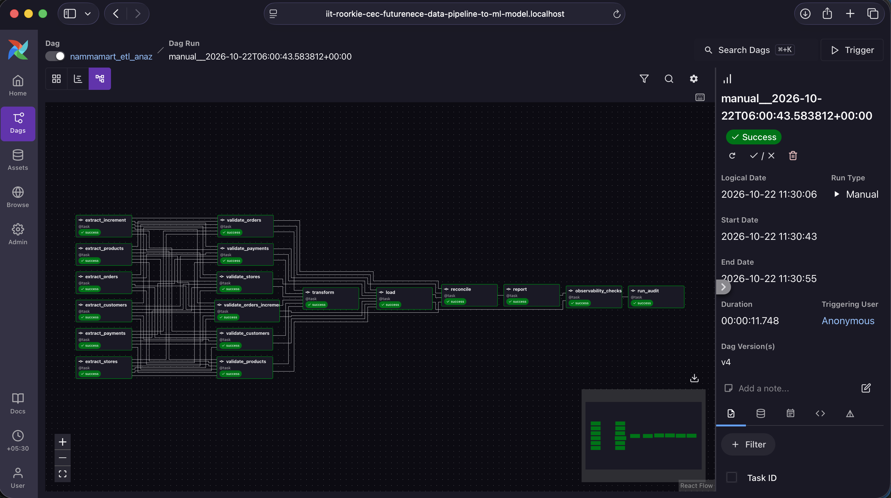 |
| ELT DAG, Graph view, green run | 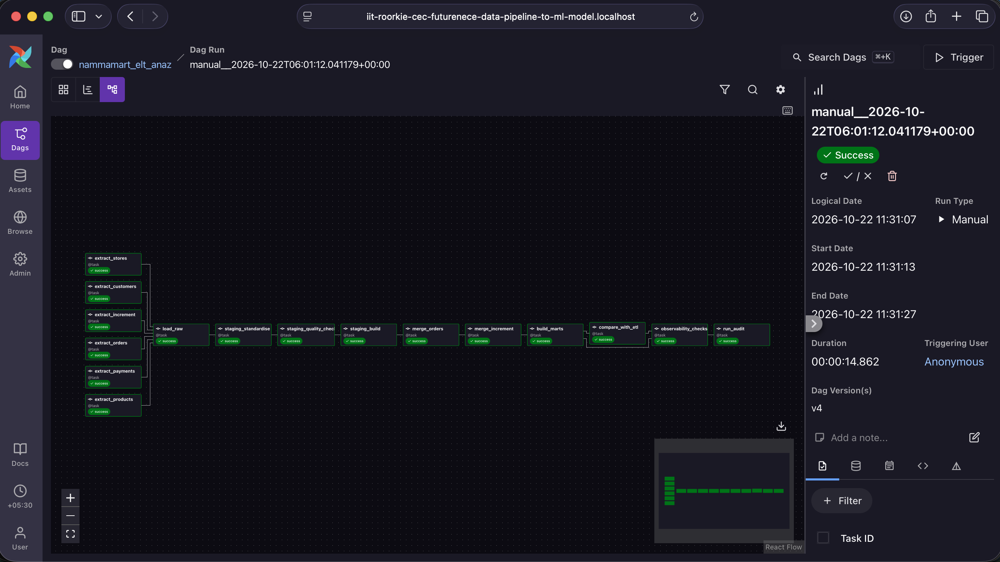 |
| Schedule: Latest Run 09:00 ✓, Next Run 2026-10-23 09:00 (IST) | 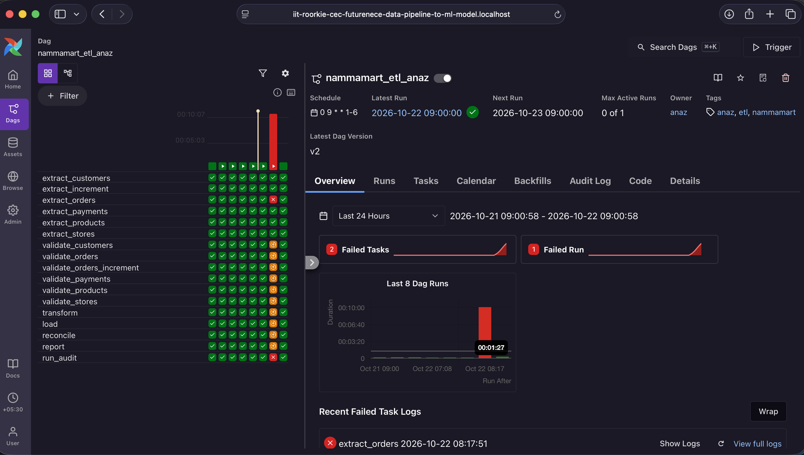 |
| Runs tab: `scheduled__2026-10-22T03:30:00+00:00` (= 09:00 IST) | 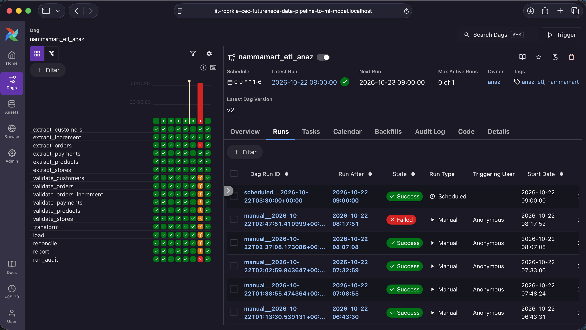 |
| One quarantine file with `failure_reason` | 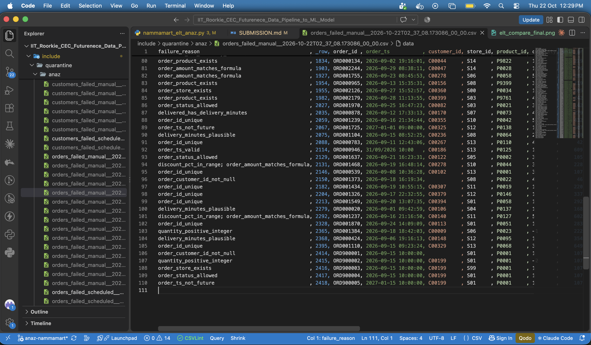 |
| `pipeline_runs` query result | 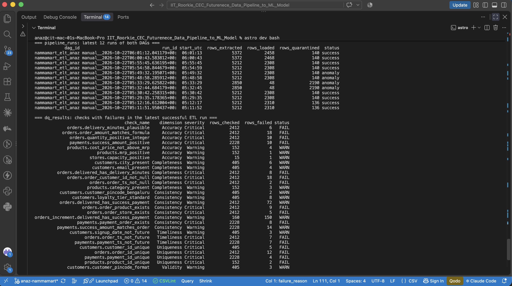 |
| Payment reconciliation table (mismatches by reason) | 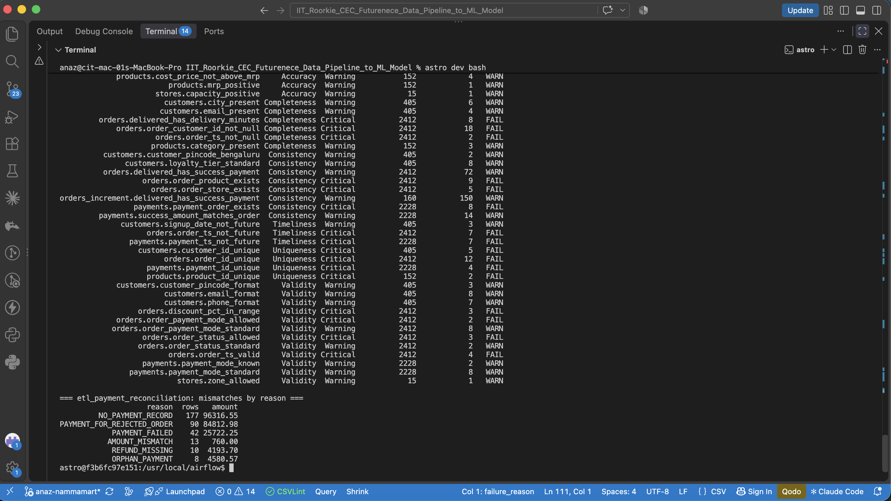 |
| Experiment 4: missing file, tries 1–3 failed | 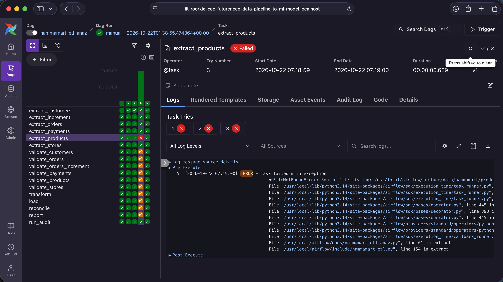 |
| Experiment 10: Clear dialog (12 affected tasks) and try 4 ✓ | 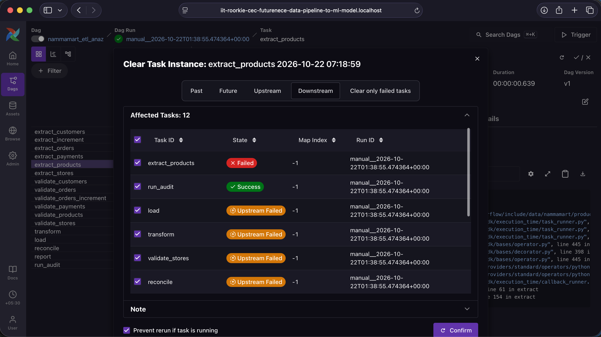 |
| Experiment 6 / 8b: run red, `observability_checks` failed | 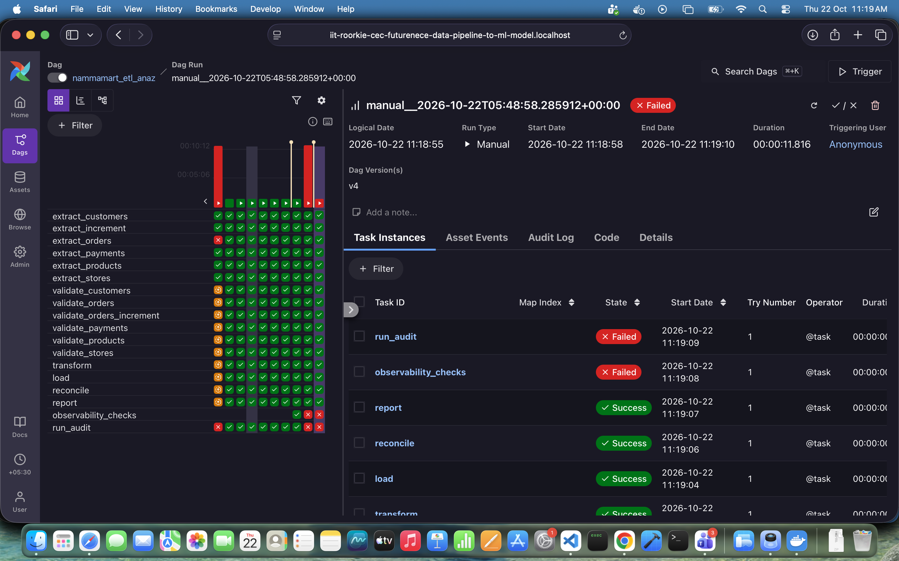 |
| Final state: `compare_with_etl` ETL and ELT MATCH (₹1,130,769.10) | 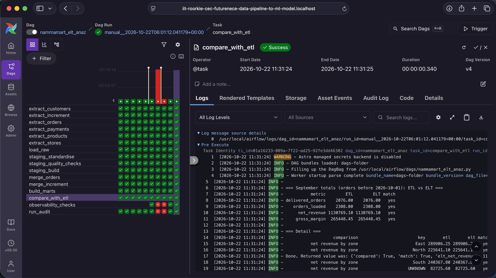 |

*If you use different file names, change the paths above. GitHub shows these images inline.*
